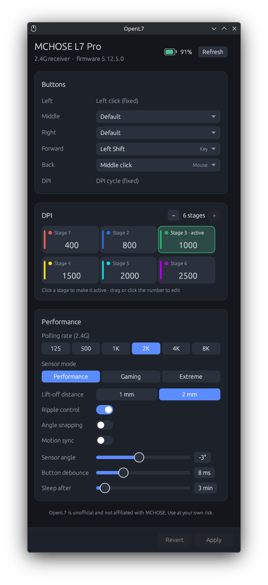
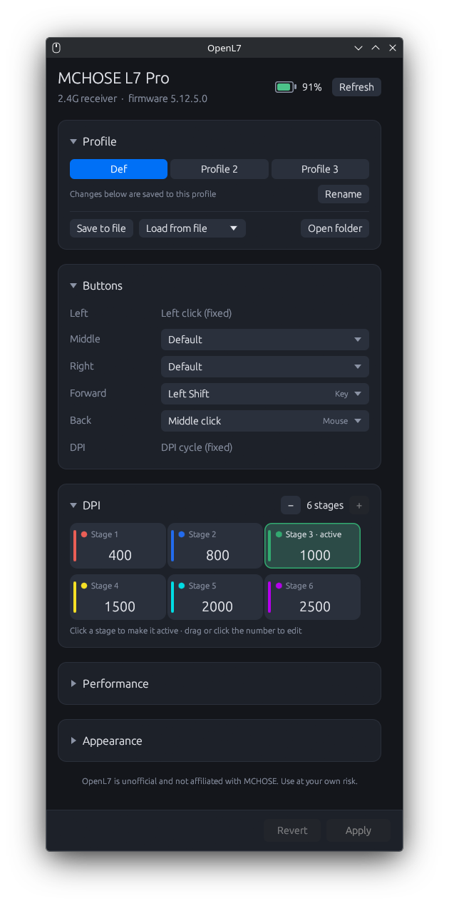
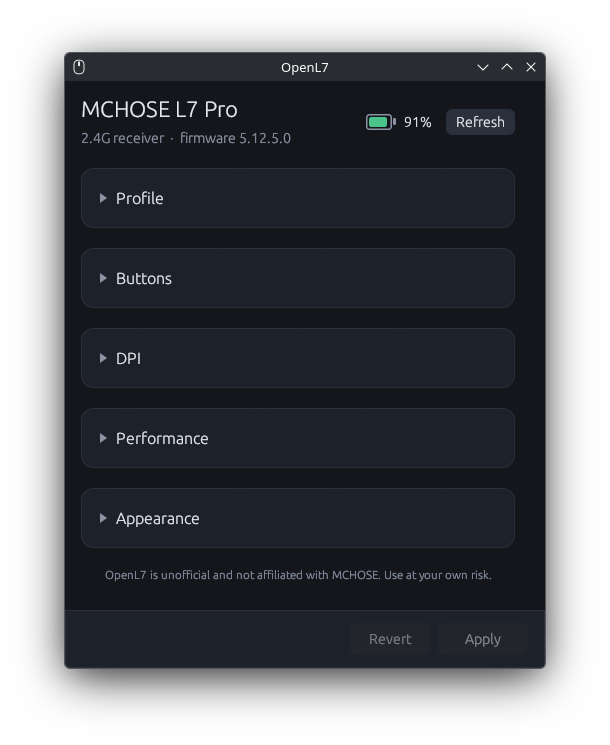

# OpenL7

Open-source Linux tray app, settings window, and CLI for the **MCHOSE L7 Pro** mouse. It talks to the
mouse directly over hidraw, with no web driver needed.

> [!WARNING]
> **Unofficial project. Use at your own risk.** OpenL7 is not made, endorsed or supported
> by MCHOSE. It was built by reverse-engineering the M HUB web driver and writes settings
> directly to the mouse's memory. It verifies every write, but it comes with no warranty
> (see [LICENSE](LICENSE)). If a setting ever ends up wrong, MCHOSE's official M HUB can
> factory-reset the mouse. Firmware updates are deliberately left to M HUB.

<p align="center">
  
  
  
</p>

- Tray icon showing battery level (optionally as a number), with low-battery notifications from 25% down
- Settings window: DPI stages with indicator colours, polling rate, sensor mode, lift-off,
  ripple / angle snapping / motion sync, sensor angle, debounce, sleep, button remapping,
  onboard profiles (switch, rename, save to and load from files), accent colour
- [Command line](#command-line) for every mouse setting
- Works over the 2.4G receiver and the USB cable

The protocol was worked out from the vendor's M HUB WebHID driver. Every write is read back
and verified.

## Build & install

```sh
cargo build --release
cp target/release/openl7 ~/.local/bin/
```

Run `openl7` for the tray icon, or `openl7 gui` for the settings window.

Your user needs read/write access to the mouse's hidraw device, for example with a udev rule:

```
KERNEL=="hidraw*", SUBSYSTEM=="hidraw", ATTRS{idVendor}=="5253", TAG+="uaccess"
```
## Hardware test

`cargo test --release -- --ignored` changes several settings on a connected mouse, then
restores them and checks every byte.


## Command line

Everything stored on the mouse can be changed from a terminal too. Changes go to the
active profile and are verified like the window's.

```sh
openl7 battery                        # battery level
openl7 info                           # everything on the mouse
openl7 set dpi 3 1600                 # DPI of stage 3
openl7 set stage 2                    # active DPI stage
openl7 set rate 4000                  # polling rate for the current connection
openl7 set mode gaming                # sensor mode: performance, gaming, extreme
openl7 set angle -3                   # sensor angle
openl7 set lod 1                      # lift-off distance (mm)
openl7 set motion-sync on             # also ripple, angle-snap
openl7 set debounce 4                 # ms; also sleep (minutes)
openl7 set button back ctrl+shift+t   # a key, a combo, or a named action
openl7 set button forward volume-up
openl7 profile                        # list onboard and saved profiles
openl7 profile 2                      # switch profile
openl7 profile rename 2 FPS
openl7 profile save backup            # to ~/.config/openl7/profiles
openl7 profile load backup
```

`openl7 --help` lists every setting and named button action.

## Licence

MIT, see [LICENSE](LICENSE).
